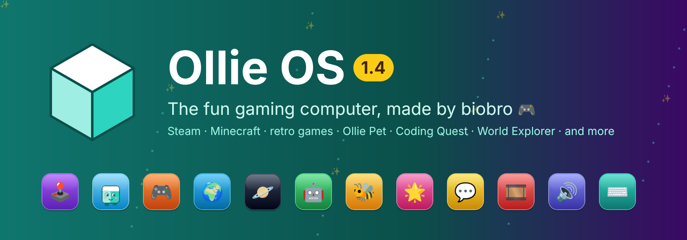
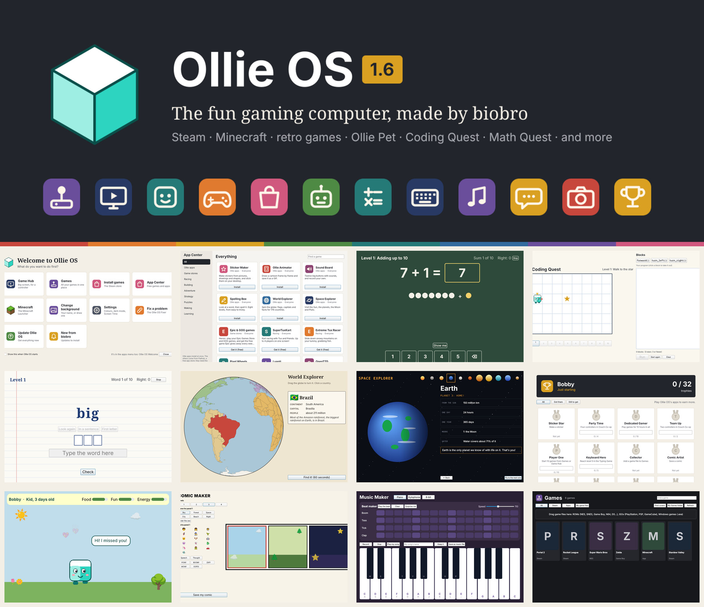
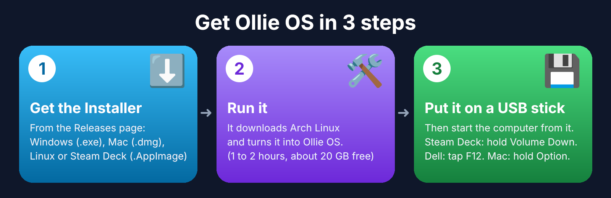

# Ollie OS

**The fun gaming computer, made by biobro.** Ollie OS is built on Arch Linux
and starts straight into a colourful desktop with Steam (and its big-screen
Game Mode), Minecraft, retro games, and a whole set of its own apps for
playing, making and learning.



- **Play:** Games (drop in ROMs and ISOs), Couch Co-op, Typing Game, Ollie Pet
- **Make:** Sticker Maker, Comic Maker, Ollie Animator, Sound Board
- **Learn:** Coding Quest, World Explorer, Space Explorer, Spelling Bee
- **Keep it going:** one-click updates, the Update Checker, Recovery Mode,
  The Fixer, and parent settings (Screen Time, Typing Scanner, Firefox password)

## How to get it



1. **Get the Installer** from the [Releases page](../../releases): Windows
   (`.exe`, inside the zip), Mac (`.dmg`, inside the zip), or Linux and Steam
   Deck (`.AppImage`).
2. **Run it.** It downloads the official Arch Linux ISO and turns it into
   Ollie OS on your computer. It takes 1 to 2 hours and about 20 GB of free
   space. No GitHub account or sign-in needed.
3. **Put it on a USB stick** (it asks at the end), then start the computer
   from the stick: Steam Deck and Steam Machine, hold **Volume Down**; Dell,
   tap **F12**; Mac, hold **Option**. Try it out, and if you like it, open
   **Install Ollie OS** on its desktop.

**Already have Ollie OS?** Download the **Ollie OS 1.4 Updater** and open it:
it brings everything new, then Update Ollie OS gets the rest. Later versions
can go on with **Recovery Mode**, keeping all your files.

## Questions

**Is it free?** Yes. Ollie OS is free, and so is Arch Linux, which it is built on.

**Will it delete Windows?** Not unless you choose that. Trying it from a USB
stick changes nothing on the computer. *Install Ollie OS* asks how: onto a
drive, which erases that drive (it warns you if Windows is on it), or into a
drive or folder *keeping everything on it*, where Ollie OS goes in one big
file. If Windows is on another drive, Ollie OS can put it on the start-up
menu so you pick each time.

**What computers does it work on?** 64-bit PCs and laptops with Intel or AMD
chips (new ones and older BIOS ones), Intel Macs, and the Steam Deck and
Steam Machine. It doesn't work on phones, tablets, Chromebooks with ARM
chips, or Macs with Apple chips (M1 and newer).

**What do I need?** A USB stick of 32 GB or more, and to install it, a drive
with at least 25 GB.

**Can I play my games?** Steam and its games (with Proton for Windows games),
Minecraft (the official launcher), retro games from ROMs and ISOs in the
Games app, and Windows programs with Oliver.

**Is it OK for kids?** It was made by one! Grown-ups can set Screen Time, the
Typing Scanner and a Firefox password in Ollie OS Settings, locked with a
parent PIN.

**How do I get updates?** Switch on the Update Checker (the first start
asks): when there's a new update you get a notification with an Install
button. Update Ollie OS keeps everything else up to date in one click.

---

# Oliver

Run Windows programs on Linux using the best of the compatibility runtimes you
already have installed.

If you have collected Wine, a few Proton builds, and whatever Lutris and
Bottles dropped on your disk, the hard part is no longer *having* a runner —
it is knowing which one to use for a given `.exe`, and remembering the
incantation to drive it. Oliver answers that question for you and then runs
the program.

```console
$ oliver run ~/Downloads/setup.exe
→ setup.exe  via wine-9.2-staging (wine-9.2-staging)
· creating a new Windows environment at ~/.local/share/oliver/prefixes/setup-7d0d55
· isolated 2 folders from your real home directory
```

## What makes it different

**It reads the executable.** Oliver parses the PE header rather than guessing
from the file name: architecture, graphical or console, .NET, which Direct3D
version it imports, and which Windows release it was built for. It recognises
Inno Setup, NSIS, InstallShield and MSI packages by their signatures, and spots
games by the Steamworks, Unity and Unreal files sitting next to them.

**It finds every runtime you have.** System Wine packages, Proton builds in
every Steam library (including ones on other drives — it reads
`libraryfolders.vdf`), Proton-GE in `compatibilitytools.d`, and the private
runner collections belonging to Lutris, Bottles, Heroic, PlayOnLinux and
CrossOver.

**It picks the right one, and tells you why.**

```console
$ oliver why ~/Downloads/setup.exe
program: /home/u/Downloads/setup.exe
profile: app (installer)

→ wine-9.2-staging (wine-9.2-staging)  149 points
    wine · lutris · 32+64
    +100  Wine
          32-bit executable, and this build supports 32-bit
    + 25  plain Wine is the reliable way to run an installer
    +  6  Staging carries patches not yet in upstream Wine
    + 18  version wine-9.2-staging

  GE-Proton9-20 (GE-Proton9-20)  75 points
    proton · compatibilitytools.d · 32+64
    +100  Proton
     -45  installers are unreliable inside Proton's container
    ...

  wine (wine-9.0)  cannot run this program
    wine · system · 64-only
    BLOCKED  wine has no 32-bit support and this is a 32-bit executable
```

That last case is the one that costs people an afternoon: the newest Wine on
the system is 64-bit only, and half the installers in the world are still
32-bit.

**It tells you when a program cannot work at all.** Some Windows software
needs raw block devices, kernel drivers or real administrative privilege —
things no compatibility layer can hand a translated process. Oliver reads the
embedded manifest and version resource, recognises these tools by the identity
they declare rather than by their file name, and says so before the launch
rather than letting them fail in a way that looks like a bug in the runner:

```console
$ oliver info downloaded_file.exe
  identifies as Rufus 3.10.1647 (Akeo Consulting)
  privileges    requireAdministrator
  compressed    UPX

WILL NOT WORK: Rufus needs hardware access that no compatibility layer provides
  Rufus writes boot records to raw USB devices. That needs direct access to
  physical drives and the Windows storage ioctls, neither of which a
  translated Windows process gets, so the device list stays empty and most
  controls stay disabled.
  Use a native writer instead: Ventoy, GNOME Disks, KDE ISO Image Writer,
  Fedora Media Writer, or `dd`.
```

It still launches the program if you ask it to — the warning is information,
not a refusal.

**You can hand a program one real disk, deliberately.** Windows disk utilities
expect to open drives directly, and a prefix has access to none by default —
which is why they show an empty device list. `oliver device` exposes exactly
one drive and nothing else:

```console
$ oliver device list
DEVICE         SIZE      TYPE       ACCESS      MODEL          IN USE BY
/dev/nvme0n1   477.0 GB  fixed      read/write  SSD 980        the running system (/, /boot/efi)
/dev/sda       28.6 GB   removable  read/write  SanDisk Ultra

$ oliver device attach my-prefix /dev/sda
```

It refuses to attach the disk the running system lives on, warns when the
device is fixed rather than removable or still has filesystems mounted, and
tells you plainly when you lack the permissions to write to it — since mapping
a device cannot grant access your user does not have.

**It keeps programs out of your home directory.** Wine points a prefix's
Documents, Desktop and Downloads at your real ones. Oliver replaces those links
with ordinary folders, so an installer cannot scribble on your files, and
disables `winemenubuilder` so nothing litters your application menu.

**Every program gets its own environment**, keyed to the directory it lives
in — so a program's launcher, main binary and uninstaller share one prefix,
while two unrelated programs never disturb each other's settings.

**Nothing happens behind your back.** `--dry-run` prints the exact commands and
environment, ready to paste into a shell.

**A failed launch leaves evidence.** A program started from a file manager has
no terminal, so when it dies on startup all you see is a spinner that flashes
and disappears. Every run is recorded instead:

```console
$ oliver log -problems
err:module:import_dll Library MSVCP140.dll not found
wine: failed to initialise the prefix
```

`oliver log` prints the whole thing, `-list` shows past runs. When a run fails
without a terminal attached, the same summary is raised as a desktop dialog
rather than vanishing.

**It can wrap a program into an AppImage.** For software with no Linux build
at all, `oliver pack` produces a single file that runs it anywhere:

```console
$ oliver pack ~/Downloads/SomeApp.exe
✓ built SomeApp-x86_64.AppImage
```

The result carries the program and Oliver — not a copy of Wine. On each machine
it uses whichever runtime is installed there, so it stays a few megabytes and
improves as the host improves. The program gets a stable prefix and a writable
copy of itself, so an AppImage's read-only mount and changing mount path do not
break programs that keep files next to their own executable.

Most Windows software ships as an installer rather than as the program itself.
Say what the installer produces, and the AppImage installs once on first
launch and starts the installed program every time after:

```console
$ oliver pack Setup.msi -launches TheProgram.exe -name "The Program"
```

To add a packed program to your application menu, run it once with
`--install`; the entry it writes records where the AppImage actually is, so it
keeps working. `--uninstall` removes it again.

Packing does not change whether a program works. If it fails under Wine, it
fails the same way packed.

## Install

Download the AppImage, make it executable, and register it with your desktop:

```console
$ chmod +x Oliver-x86_64.AppImage
$ ./Oliver-x86_64.AppImage desktop install --default
```

That last step is what lets you double-click an `.exe` in your file manager, or
reach Oliver from "Open With". Undo it with `desktop uninstall`.

The AppImage is a single statically linked file with no dependencies — no
glibc version to match, nothing to install.

### From source

```console
$ make build        # ./dist/oliver
$ make appimage     # ./dist/Oliver-<version>-x86_64.AppImage
$ make check        # format, vet and test
```

Go 1.24 or newer. The build has no third-party dependencies.

## Using it

```console
oliver run <program.exe> [arguments...]   run it, choosing a runtime for you
oliver info <program.exe>                 what it is and what it needs
oliver why <program.exe>                  how every runtime scored, and why
oliver backends                           what is installed on this machine
oliver prefix list                        the Windows environments Oliver made
oliver doctor                             what is missing, and how to fix it
oliver desktop install                    open .exe files by double-clicking
```

Useful flags for `run`:

| Flag | Effect |
| --- | --- |
| `-b, --backend <name>` | force a runtime (`-b ge`, `-b staging`) |
| `-p, --prefix <name>` | use a named environment instead of the derived one |
| `--profile game\|app` | override the automatic classification |
| `--winver win7` | report a specific Windows version |
| `-e KEY=VALUE` | add an environment variable (repeatable) |
| `-n, --dry-run` | print the commands instead of running them |
| `-v, --verbose` | keep Wine's diagnostic output |
| `--json` | machine-readable output |

Oliver exits with the program's own exit status, so it drops into scripts
without surprises.

## Configuration

Optional, at `~/.config/oliver/config.json`. Write a starter file with
`oliver config init`.

```json
{
  "profile": "auto",
  "winver": "auto",
  "env": ["DXVK_HUD=fps"],
  "runner_dirs": ["/mnt/games/wine-builds"],
  "rules": [
    { "match": "**/Photoshop*/*.exe", "backend": "staging", "winver": "win7" },
    { "match": "*.msi", "backend": "wine" }
  ]
}
```

Rules are matched in order against the executable's full path; the first match
wins. `*` stays within one path segment, `**` crosses them, and matching
ignores case. A flag on the command line always beats a rule.

## How the choice is made

Each runtime starts from a base score for its family, then gains and loses
points:

- **Architecture** is a hard gate. A 32-bit program against a runtime with no
  32-bit support is rejected outright, with the reason shown, rather than
  failing at launch.
- **Installers** strongly prefer plain Wine; Proton's container makes them
  unreliable. This holds even when the installer links Direct3D.
- **Games** prefer Proton, which bundles DXVK and VKD3D-Proton, and prefer GE
  builds over stock ones.
- **Ordinary applications** prefer plain Wine, which starts faster and
  integrates with the desktop.
- **Newer versions** score higher, capped so that a newer but unsuitable
  runtime never beats the right kind of runtime.
- **Proton without `umu-launcher`** is penalised, since it then has to run
  without the Steam runtime.

`oliver why` prints the whole table with every adjustment, so when the choice
is wrong you can see exactly which rule to override.

## Notes

Oliver runs Proton through [umu-launcher] when it is installed, which is the
supported way to use Proton outside Steam. Without it, Proton still works via
its own entry point, but with fewer guarantees — `oliver doctor` will say so.

Prefixes are laid out the way Steam lays them out: the environment directory
holds a `pfx` subdirectory that is the real `WINEPREFIX`. Wine and Proton
therefore agree on where a prefix lives, and you can move a program between
them without rebuilding its environment.

[umu-launcher]: https://github.com/Open-Wine-Components/umu-launcher

## Ollie OS

[`os/`](os/README.md) builds Ollie OS, a bootable desktop built around Oliver.
It is sized for a 32 GB drive, ready for Steam, and double-clicking an `.exe`
runs it.

## Licence

MIT. See [LICENSE](LICENSE).
