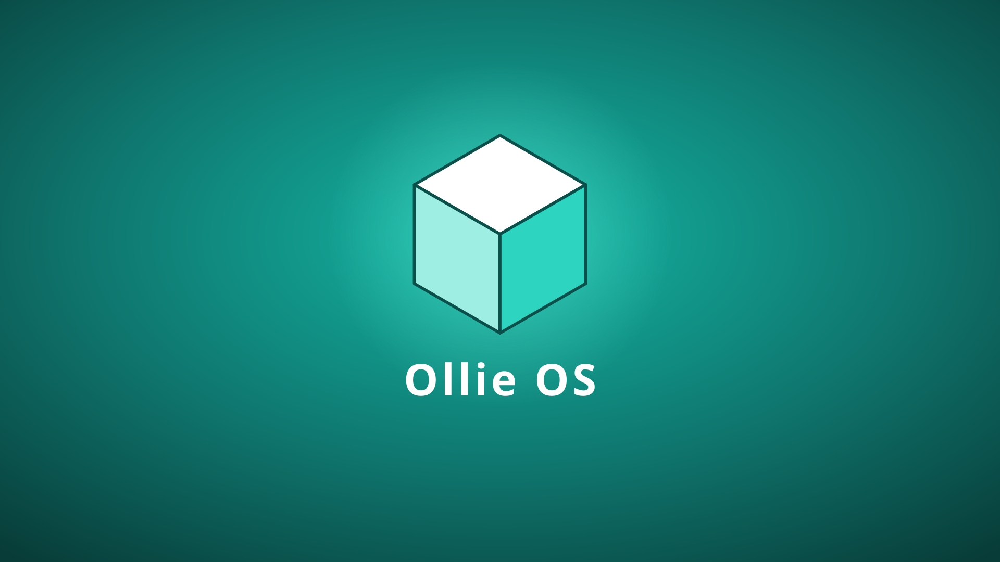

# Ollie OS

A desktop Linux made for running Windows programs and Steam games, sized for a
32 GB ("29 GB") drive, and tuned for Valve hardware: the Steam Machine and
Steam Deck.



## What you get

- **A teal desktop with the Ollie cube.** Right-click any PNG or JPEG and
  choose **Set as wallpaper** to use it instead.
- **One bar along the bottom.**
  - **Left:** the cube button opens the app menu, and next to it is a
    **Google search box**. Type, press Enter, and the results open in
    Firefox. Typing a web address such as `youtube.com` goes straight there.
  - **Right:** your pinned apps, then the tray and the clock. To pin an app,
    right-click it and choose **Add to bar**. That works on desktop icons,
    on apps in Dolphin, and on Windows `.exe` files. In the app menu, the
    same option is called **Pin to Task Manager**.
- **`.exe` files just run.** Double-click one and [Oliver](../README.md)
  chooses the best runtime installed (Wine, Proton or Proton-GE) and starts
  it.
- **Preinstalled:** Firefox, Steam, Wine (with Mono),
  Oliver, the Dolphin file manager, Konsole, Kate and a screenshot tool.
  **Get Proton-GE** in the app menu downloads Proton-GE (about 500 MB) when
  you want it; it is not on the ISO, so the ISO stays one file under 2 GB.
- **The Fixer** (in the app menu) checks every system program for missing
  or damaged files, shows what it found and, when you agree, puts good
  copies back from Ollie OS's own copy of the system: the read-only image
  on the USB, or the 2 GB copy the installer keeps on the drive. A program
  updated since Ollie OS was made is downloaded again instead. Your own
  files and settings are never touched.
- **DC - Debug Computer** (pinned to the bar) checks everything: memory,
  storage, temperature, internet, graphics and Vulkan, sound, Bluetooth,
  Steam, Proton, Wine and Oliver, stuck updates, and recent errors. It
  explains each problem in plain words, offers to fix what it can, and
  saves a report to the desktop.
- **Driver Installer** looks at the hardware (NVIDIA, AMD and Intel
  graphics, Broadcom Wi-Fi, sound, printers, scanners, Logitech receivers,
  drawing tablets, virtual machines) and installs the drivers it needs.
- **Bibata cursor:** a rounded white mouse pointer with smooth animations,
  on the desktop and in games.
- **Steam Machine and Steam Deck support:** AMD graphics drivers (32- and
  64-bit), Steam's controller rules, Deck audio firmware, and a
  **Steam Game Mode** app
  in the menu that opens Big Picture full screen, like a Deck.
- **Your own username and password, made on first start.** The first time
  Ollie OS starts, a welcome window asks you to create a username and
  password; from then on it shows a login screen. Choose **Skip** to keep
  going straight to the desktop with no password. On a USB drive the choice
  is saved on the drive itself, so it is remembered even on a drive that
  starts fresh every time. Admin tasks (DC, the Driver Installer, updates,
  formatting drives) never ask for a password, and the screen never locks.

## Built for a 29 GB drive

The installed system takes exactly **25 GB**:

| Partition | Size    | What                                                 |
|-----------|---------|------------------------------------------------------|
| boot      | 512 MB  | kernel and boot loader (systemd-boot)                |
| root      | 24.5 GB | btrfs with zstd compression; `@` and `@home` volumes |
| free      | rest    | about 4 GB left unpartitioned on a 32 GB stick       |

To make those 25 GB go further, there is no swap partition: compressed swap
lives in memory instead (zram). Old package downloads are cleaned up every
week, and system logs are capped at 200 MB.

## Getting the ISO

GitHub builds it: **Actions → Ollie OS ISO → latest run → Artifacts →
`ollie-os-iso`**. The ISO is about 3–4 GB. A build starts on every push that
touches `os/`, and can also be started by hand with **Run workflow**. Pushing
a tag named `os-v1.0` (or any `os-v*`) also publishes a GitHub release.

To build on your own Arch or SteamOS machine (needs Docker and about
20 GB free):

```console
$ docker run --rm --privileged -v "$PWD:/src" -w /src archlinux:latest bash os/build.sh
$ ls os/out/
ollie-os-2026.10.05-x86_64.iso  ollie-os-2026.10.05-x86_64.iso.sha256
```

## Only one drive? Use Ollie OS USB Maker

**Ollie OS USB Maker** is an AppImage that puts Ollie OS on a single drive
and runs it from there. It keeps your files, settings and installed games,
and asks you to create a username and password the first time it starts.
You don't need a second drive.

1. Download `Ollie-OS-USB-Maker-x86_64.AppImage` and the ISO from the
   **Ollie OS (newest build)** release, and put them in **Downloads**. The
   ISO comes in two parts there (a release file is at most 2 GB): download
   both into the same folder, with any names. The USB Maker finds them,
   even in a folder inside Downloads, and joins them into the ISO. You can
   also give it the folder, or a zip of the two parts (any names, also
   made on a Mac): drag it into its window, or pick it when asked.
2. Right-click the AppImage → **Properties → Permissions → Is executable**,
   then double-click it. In a terminal, run `chmod +x` on it and start it.
3. It asks only **which drive**. The username and password are made in
   Ollie OS itself, the first time it starts.
   - On a **FAT32** drive (how most USB sticks come), it copies Ollie OS on
     without erasing anything and without any password. Ollie OS then
     starts fresh every time.
   - Any other drive is reformatted (type `ERASE`) into the layout below,
     which keeps your files and games between starts.

When it has finished, it offers to **scan the drive and fix problems**. The scan:
- checks that every Ollie OS file is there and complete, and copies any missing ones again;
- checks that the boot menu starts Ollie OS from this drive;
- removes leftovers from other systems;
- checks that the drive saves files correctly.

If it finds a username and password left by an older USB Maker, it asks
whether to **remove** them (the default: Ollie OS then asks for a new one when it starts) or **set**
a new username and password, which brings back a login screen.

**Zip edition.** `Ollie-OS-USB-Maker-Zip-x86_64.AppImage` takes Ollie OS
only from a zip: of the ISO, or of its two parts, with any names. It looks
for the zip in Downloads (and the folders directly inside it), or opens a
file picker for it.

It lays the drive out like this:

| Partition   | Size   | Format       | What                                        |
|-------------|--------|--------------|---------------------------------------------|
| OLLIE_BOOT  | 5 GB   | FAT32        | Ollie OS and its boot loader                |
| OLLIE_DATA  | 20 GB  | ext4         | everything you save and install             |
| OLLIE_SHARE | rest   | exFAT/FAT32  | shared folder for Windows, macOS, SteamOS   |

Ollie OS itself uses 25 GB. On a 32 GB ("29 GB") stick about 4 GB is left
for OLLIE_SHARE.

No administrator password is needed for a USB drive. The app works through
udisks, the same service the file manager uses to format USB sticks, which
lets whoever is using the computer change removable drives. Only if that is
refused does it ask for an administrator password (on SteamOS, set one with
`passwd` in Konsole).

Running from the drive this way, the kernel is not updated: the
`linux` package is held back automatically. Everything else updates normally.

## Writing it to a drive

`ollie-write` copies the ISO onto a USB stick or drive. It runs on any Linux,
including SteamOS desktop mode, and comes with Ollie OS too, as
**Write ISO to Drive**:

```console
$ sudo ./os/ollie-write ollie-os-2026.10.05-x86_64.iso
==> Image: ollie-os-2026.10.05-x86_64.iso (3412 MB)
==> Drives you can write to:

  1) /dev/sdb         28.9G  removable SanDisk Ultra

Write to which drive? [1-1] 1
EVERYTHING on /dev/sdb will be erased.
Type the drive name (sdb) to continue: sdb
==> Writing (do not unplug the drive)
==> Checking what was written
==> Done. /dev/sdb is ready; boot from it to try or install Ollie OS.
```

It never lists the drive your running system is on. You have to type the
drive's name before anything is erased, and it reads the drive back to check
the copy. On Windows or macOS, write the ISO with balenaEtcher or Rufus
instead.

## Installing

1. Boot from the USB stick. On a Steam Deck or Steam Machine, hold
   **Volume Down** and press **Power** to open the boot manager.
2. On the live desktop, double-click **Install Ollie OS**.
3. Choose the drive to install onto. The USB stick you booted from is not
   offered, so you need a second drive (for example the internal SSD, or
   another USB stick).
4. Type `ERASE`, then pick a computer name and time zone. There is no
   username or password: it starts straight into the desktop.
5. Restart and log in.

## How it is put together

```
os/
├── build.sh                 builds the ISO (runs inside an Arch container)
├── ollie-write              writes an ISO to a drive
├── usb/                     Ollie OS USB Maker (AppImage): run from one drive
├── art/                     cube logo, wallpaper, boot menu splash (SVG)
└── profile/
    ├── packages.x86_64            packages from the Arch repositories
    ├── packages-optional.x86_64   added only if the repositories carry them
    ├── aur-packages.txt           built from the AUR (the cursor)
    └── airootfs/                  files copied into the system
        ├── etc/                   autologin, services, defaults
        └── usr/
            ├── local/bin/         ollie-install, ollie-add-to-bar, ...
            └── share/plasma/      the bar layout and the Google search box
```

The ISO is an [archiso](https://wiki.archlinux.org/title/Archiso) image. The
build starts from archiso's `releng` profile for the boot loader setup, then
layers `profile/` on top. The desktop is KDE Plasma 6 on Wayland. Its bar is
the layout script in
`profile/airootfs/usr/share/plasma/look-and-feel/org.ollieos.desktop/`, and
the search box is the small widget in
`profile/airootfs/usr/share/plasma/plasmoids/org.ollieos.googlesearch/`.
